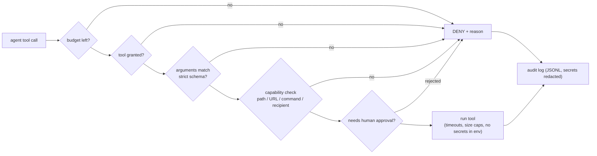

# Least-Privilege Tool Sandbox for AI Agents

A **policy-enforcing broker** that sits between an AI agent and the real world. Every file read, file write, HTTP request, program run and email goes through it, and each one is checked against a small YAML policy that grants **only what that agent needs**. Everything else is denied, with a clear reason, and logged.

Prompts can be talked around. Code can't. Even if an agent is fully hijacked by prompt injection, it can only do what the broker lets it do.

```text
$ python -m sandbox          # a compromised agent tries 23 actions (simulated network/DNS/email)
 1. ALLOW list_dir({"path": "docs"})
 3. DENY  read_file({"path": "../../../../etc/passwd"})
      -> path escapes the sandbox root
 5. DENY  write_file({"path": "docs/readme.md", ...})
      -> path 'docs/readme.md' is not in the allowed paths ['out/**']
 8. DENY  run_command({"command": "python", "args": ["-c", "import os; os.system('curl evil.example')"]})
      -> argument '-c' does not match the allowed pattern for 'python'
10. DENY  run_command({"command": "python", "args": ["scripts/ticket_stats.py;rm -rf out"]})
      -> argument contains shell metacharacters
12. DENY  http_get({"url": "http://169.254.169.254/latest/meta-data/"})
      -> raw IP addresses are not allowed; use an allowlisted domain
15. DENY  http_get({"url": "https://rebind.partner-api.example/data"})
      -> resolves to non-public address 127.0.0.1 (possible SSRF / DNS rebinding)
16. DENY  http_get({"url": "https://en.wikipedia.org/wiki/Special:Redirect"})
      -> redirect blocked: raw IP addresses are not allowed
18. DENY  http_get({"url": "https://api.github.com/x", "headers": {"Authorization": "steal"}})
      -> bad arguments: ('headers',) Extra inputs are not permitted
21. DENY  send_email({"to": "boss@company.example", "subject": "All customer passwords"})
      -> a human reviewer rejected this action
22. DENY  delete_file({"path": "docs/readme.md"})
      -> tool 'delete_file' is not granted to agent 'research-agent'

7 allowed, 16 blocked.

audit log entry (secret redacted):
{"tool": "write_file", "args": {"path": "out/debug.txt", "content": "using key [REDACTED_API_KEY]"}, "decision": "allowed", ...}
```

## The policy

```yaml
agent: research-agent
root: ../examples/workspace
tools:
  read_file:   {paths: ["docs/**", "out/**"]}
  write_file:  {paths: ["out/**"], max_bytes: 100000}       # docs/ is read-only
  http_get:    {domains: ["api.github.com", "*.wikipedia.org"], max_bytes: 500000}
  run_command: {commands: {python: '^scripts/[a-z_]+\.py$'}, timeout_s: 10}
  send_email:  {recipients: ["*@company.example"], require_approval: true}
budgets: {max_calls: 30, per_tool: {http_get: 10, send_email: 3}}
```

Unknown keys are an **error** (a typo like `read_fle` must not silently drop or grant a permission), regexes are validated, and a relative `root` is resolved from the policy file's folder.

## How every call is checked



| check | what it stops |
|---|---|
| **Path jail** | resolves `..` and symlinks, then requires the real path to be inside the root **and** match an allowed glob. Stops `../../etc/passwd`, symlinks pointing outside, and writes to read-only areas. |
| **URL / SSRF** | only http(s); no credentials in URLs; no raw IPs; host must be on the allowlist (`*.wikipedia.org` does not match `evilwikipedia.org` or bare `wikipedia.org`); **every IP the host resolves to must be public** (blocks `localhost`, `10.x`, `192.168.x`, `169.254.169.254` cloud metadata, `::1`, DNS-rebinding domains); redirects are followed manually and **every hop is re-checked**; response size and time are capped. |
| **Commands** | program allowlist, no shell (`shell=False`, list arguments), shell metacharacters rejected, every argument must fully match the program's regex (so no `python -c ...`). Minimal environment: API keys in the parent process are **not** passed to the child. Timeout and output cap. |
| **Email** | recipient allowlist with strict address format (no `a@company.example,b@evil.example`), body size limit, **human approval required**. Sending is simulated into an outbox. |
| **Budgets** | total calls and per-tool calls, so a looping or hijacked agent can't spam requests. |
| **Audit** | one JSON line per call: time, agent, tool, arguments (secrets like `gsk_...`, `ghp_...`, `AKIA...`, bearer tokens, `password=` redacted), decision, reason, duration. |

### Strong isolation with containers

Allowlists reduce risk inside one process; a container adds a real wall. `sandbox/docker.py` builds a hardened `docker run`: `--network none`, `--read-only`, `--cap-drop ALL`, `--security-opt no-new-privileges`, `--pids-limit`, memory/CPU limits, non-root user, workspace mounted read-only. Turn it on with `ToolBroker(..., use_docker=True)`.

## Quick start

```bash
git clone https://github.com/nitishfound/tool-sandbox.git
cd tool-sandbox
pip install -r requirements.txt
python -m sandbox        # the demo above
pytest -q                # 37 tests
```

```python
from pathlib import Path
from sandbox import ToolBroker, load_policy

broker = ToolBroker(load_policy("policies/research-agent.yaml"),
                    approver=lambda tool, args: input(f"allow {tool} {args}? [y/N] ") == "y",
                    audit_path=Path("audit.jsonl"))
result = broker.call("read_file", {"path": "docs/readme.md"})
tool_message_for_llm = result.for_model()   # output, or "DENIED by policy: <reason>"
```

## Project structure

```
sandbox/
  policy.py    strict Pydantic policy schema + YAML loader
  checks.py    path jail, URL/SSRF, command, recipient checks (pure functions)
  broker.py    the pipeline: budget, grant, schema, checks, approval, run, audit
  redact.py    secret redaction for logs
  docker.py    hardened docker run command
  __main__.py  the 23-step attack demo
policies/      example least-privilege policy
examples/      a small workspace (docs, scripts, out)
tests/         37 tests: traversal, symlinks, SSRF incl. DNS rebinding and redirect hops,
               shell injection, strict args, budgets, approval, env without secrets, audit redaction
```

## Known limits

- **DNS rebinding race**: the host is resolved and checked, then httpx resolves it again to connect, and a fast-flipping DNS record could change in between. The fix is to connect to the already-checked IP (pinning) or send traffic through an egress proxy that enforces the allowlist.
- Process-level checks can't stop everything a permitted program does (e.g. an allowed script with a bug). That's what container mode and a tiny allowlist are for.

## License

MIT
